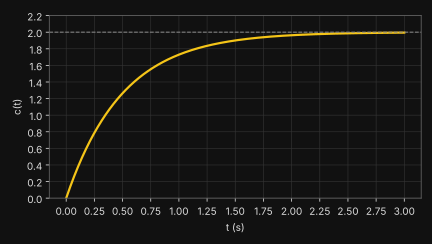
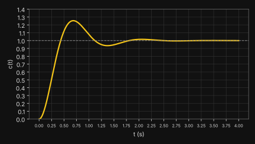

# Banco de questões — Sistemas de Controle I

## 1. [q02b] Tópico 02 · Nível 1 — Compreensão · Numérica

L{ 7·e^(4t)·t⁴ } = (N)/((s − 4)⁵). Quanto vale N?

Gabarito (tente antes)

**Resposta:** 168

**Resolução:**

Base: t⁴ → (4!)/(s⁵) = (24)/(s⁵). Expoente positivo → s vira (s − 4). Constante: 7·24 = **168**.

**Fórmula:** tⁿ → n!/sⁿ⁺¹

**Erros prováveis:** Usar 4 em vez de 4! = 24.

## 2. [q02a] Tópico 02 · Nível 2 — Aplicação · Objetiva

Qual é a transformada de Laplace de f(t) = 3·e^(−2t)·cos(4t)·u(t)?

- A) (3s)/(s² + 16)
- B) (3(s+2))/((s+2)² + 16)
- C) (3(s−2))/((s−2)² + 16)
- D) (3)/((s+2)² + 16)

Gabarito (tente antes)

**Resposta:** B

**Resolução:**

1. Base: cos(4t) → (s)/(s² + 16).
2. e^(−2t) → troca **todo** s por (s + 2): (s+2)/((s+2)² + 16).
3. Constante: × 3.

**Fórmula:** L{e^(−at)f(t)} = F(s + a)

**Por que as outras estão erradas:**

- A) Esqueceu o deslocamento em frequência.
- B) Correta.
- C) Sinal invertido: e^(−2t) gera (s **+** 2).
- D) Trocou só o s do denominador; o numerador do cosseno também é s.

**Erros prováveis:** Trocar apenas um dos s; errar o sinal do deslocamento.

## 3. [q03a] Tópico 03 · Nível 2 — Aplicação · Numérica

C(s) = (s+2)/(s(s+5)). Em c(t) = A + B·e^(−5t), quanto vale B?

Gabarito (tente antes)

**Resposta:** 0,6

**Resolução:**

Tampe (s+5) e substitua s = −5: (−5+2)/(−5) = (−3)/(−5) = **0,6** (3/5).

**Fórmula:** Resíduo: B = [F(s)(s+5)] em s = −5

**Erros prováveis:** Errar o sinal: (−3)/(−5) é positivo.

## 4. [q03b] Tópico 03 · Nível 3 — Desafio · Resolução passo a passo

(Diagnóstica Q7) h(t) = t·e^(−5t)u(t) e x(t) = t·u(t). Determine X(s), H(s), Y(s) e y(t).

Gabarito (tente antes)

**Resolução:**

1. X(s) = (1)/(s²); H(s) = (1)/((s+5)²).
2. Y(s) = H·X = (1)/(s²(s+5)²).
3. Frações: (A)/(s) + (B)/(s²) + (C)/(s+5) + (D)/((s+5)²).
4. B = 1/25 (tampa s², s=0). D = 1/25 (tampa (s+5)², s=−5).
5. A = d/ds[1/(s+5)²] em s=0 = −2/125. C = d/ds[1/s²] em s=−5 = 2/125.
6. **y(t) = t/25 − 2/125 + (t/25)e^(−5t) + (2/125)e^(−5t)** (conferido com software).

**Fórmula:** Raiz repetida: termo simples sai da derivada

**Erros prováveis:** Usar só uma fração para raiz dupla; esquecer de derivar.

## 5. [q04a] Tópico 04 · Nível 1 — Compreensão · Objetiva

Qual sinal de teste representa uma referência de **velocidade constante**?

- A) Impulso
- B) Degrau
- C) Rampa
- D) Parábola

Gabarito (tente antes)

**Resposta:** C

**Resolução:**

A rampa t·u(t) cresce com inclinação constante → velocidade constante (Aula 4, slide 5).

**Fórmula:** Rampa → 1/s²

**Por que as outras estão erradas:**

- A) Impulso é um 'chute' instantâneo.
- B) Degrau = posição constante.
- C) Correta.
- D) Parábola = aceleração constante.

**Erros prováveis:** Confundir degrau (posição) com rampa (velocidade).

## 6. [q04b] Tópico 04 · Nível 1 — Compreensão · Discursiva

(Diagnóstica/Processual Q1c) Como obter a resposta ao impulso de um sistema e o que ela representa?

Gabarito (tente antes)

**Resolução:**

Aplica-se um impulso δ(t) na entrada; como L{δ} = 1, a saída é Y(s) = G(s). Logo h(t) = L⁻¹{G(s)}. Ela representa a dinâmica natural do sistema (sua 'impressão digital'): conhecendo h(t), obtém-se a resposta a qualquer entrada.

**Fórmula:** h(t) = L⁻¹{G(s)}

**Erros prováveis:** Dizer 'entrada igual a 1' em vez de impulso.

## 7. [q05a] Tópico 05 · Nível 1 — Compreensão · Objetiva

Qual afirmação sobre sistemas em malha fechada é **correta**?

- A) Nunca podem ficar instáveis.
- B) Não precisam de sensor.
- C) Rejeitam perturbações melhor que a malha aberta, mas podem ficar instáveis.
- D) São sempre mais baratos que os de malha aberta.

Gabarito (tente antes)

**Resposta:** C

**Resolução:**

A realimentação aumenta a precisão e a rejeição a distúrbios, mas cria risco de instabilidade e custa mais (Aula 1).

**Fórmula:** —

**Por que as outras estão erradas:**

- A) A realimentação pode desestabilizar.
- B) Sem medir a saída não há realimentação.
- C) Correta.
- D) Custam mais (sensor, controlador).

**Erros prováveis:** Achar que malha fechada é sempre melhor.

## 8. [q06a] Tópico 06 · Nível 2 — Aplicação · Numérica

(Processual Q9) Massa-mola-amortecedor: G(s) = (1)/(Ms² + Bs + k), M = 20 kg, k = 320 N/m. Qual B (N·s/m) deixa o sistema **criticamente amortecido**?

Gabarito (tente antes)

**Resposta:** 160

**Resolução:**

Criticamente amortecido → raízes reais iguais → Δ = 0.
B² − 4·M·k = 0 → B² = 4·20·320 = 25 600 → **B = 160 N·s/m**.

**Fórmula:** Δ = B² − 4Mk = 0

**Erros prováveis:** Usar ζ = B/2 sem normalizar; esquecer o fator 4.

## 9. [q06b] Tópico 06 · Nível 2 — Aplicação · Objetiva

(Diagnóstica Q1) Qual a FT Y(s)/X(s) de 2y'' + y' + 6y = x?

- A) (1)/(2s² + s + 6)
- B) (2s² + s + 6)/(1)
- C) (1)/(s² + s + 6)
- D) (2)/(s² + s + 6)

Gabarito (tente antes)

**Resposta:** A

**Resolução:**

Derivadas viram potências de s: (2s² + s + 6)Y = X → Y/X = (1)/(2s² + s + 6).

**Fórmula:** d/dt → s (CI nulas)

**Por que as outras estão erradas:**

- A) Correta.
- B) Invertida (entrada/saída).
- C) Perdeu o 2 de y''.
- D) Dividiu errado.

**Erros prováveis:** Inverter a fração.

## 10. [q07b] Tópico 07 · Nível 1 — Compreensão · Discursiva

(Lista 2º bim Q4) Utilizando um diagrama de blocos, explique o que representa E(s) = R(s)[1 − T(s)].

Gabarito (tente antes)

**Resolução:**

Num sistema com realimentação unitária, o somador calcula E = R − C. Como C = R·T, tem-se E = R − R·T = R(1 − T). E(s) é o **sinal de erro**: a diferença entre a referência e a saída, que entra no controlador. Usando o teorema do valor final, e(∞) = lim s→0 s·R(s)[1 − T(s)].

**Fórmula:** E = R − C; C = R·T

**Erros prováveis:** Confundir E(s) com a saída.

## 11. [q07a] Tópico 07 · Nível 2 — Aplicação · Objetiva

(Diagnóstica Q6 / Processual Q5) Caminho direto (1)/(s+4), realimentação negativa (1)/(s). Quanto vale Y(s)/U(s)?

- A) (s)/(s² + 4s + 1)
- B) (1)/(s² + 4s + 1)
- C) (s)/(s + 4)
- D) (1)/(s(s+4))
- E) (s+4)/(s(s²+4s+1))

Gabarito (tente antes)

**Resposta:** A

**Resolução:**

T = G/(1 + GH) = (1/(s+4))/(1 + 1/(s(s+4))). Multiplicando por s(s+4): (s)/(s² + 4s + 1).

**Fórmula:** T = G/(1 + GH)

**Por que as outras estão erradas:**

- A) Correta.
- B) Perdeu o s do numerador ao simplificar.
- C) Ignorou a realimentação.
- D) Multiplicou G·H (série) em vez de realimentar.
- E) Erro de simplificação.

**Erros prováveis:** Esquecer o H no produto GH.

## 12. [q08a] Tópico 08 · Nível 1 — Compreensão · Interpretação de gráfico

(Diagnóstica Q4 / Processual Q2) Mapa de polos e zeros: **○ em −3 e +1**; **× em −6, −2 e 0**. Qual H(s)?

- A) ((s+3)(s−1))/(s(s+2)(s+6))
- B) ((s+3)(s+1))/((s+6)(s+2)(s−2))
- C) ((s+3)(s−1))/((s+6)(s+2))
- D) ((s+6)(s+2)s)/((s+3)(s−1))
- E) (1)/((s+3)(s−1)(s+2)(s+6))

Gabarito (tente antes)

**Resposta:** A

**Resolução:**

○ = zeros → numerador (s+3)(s−1). × = polos → denominador s(s+2)(s+6).

**Fórmula:** raiz em p → fator (s − p)

**Por que as outras estão erradas:**

- A) Correta.
- B) Sinais e polos errados.
- C) Faltou o polo na origem.
- D) Invertido: polos no numerador.
- E) Zeros tratados como polos.

**Erros prováveis:** Trocar × com ○; errar o sinal do fator.

## 13. [q08b] Tópico 08 · Nível 2 — Aplicação · Objetiva

(Processual Q6) G(s) = (s−1)/(s² + 2s + 10). Sobre a estabilidade:

- A) Instável, polo com parte imaginária positiva.
- B) Instável, zero no semiplano direito.
- C) Marginalmente estável, polos no eixo imaginário.
- D) Instável, zero complexo.
- E) Estável, polos com parte real negativa.

Gabarito (tente antes)

**Resposta:** E

**Resolução:**

Polos: s = −1 ± j3 (parte real −1 < 0). Estabilidade depende só dos polos → **estável**.

**Fórmula:** Δ = 4 − 40 = −36 → s = −1 ± j3

**Por que as outras estão erradas:**

- A) Parte imaginária não define estabilidade.
- B) Zeros não definem estabilidade.
- C) A parte real é −1, não 0.
- D) O zero é real (+1).
- E) Correta.

**Erros prováveis:** Achar que zero no SPD desestabiliza.

## 14. [q09a] Tópico 09 · Nível 2 — Aplicação · Numérica

G(s) = (50)/(s + 50). Qual o tempo de acomodação T_s (em segundos)?

Gabarito (tente antes)

**Resposta:** 0,08

**Resolução:**

Polo em −50 → a = 50. T_s = 4/a = 4/50 = **0,08 s**.

**Fórmula:** T_s = 4/a

**Erros prováveis:** Usar o numerador; usar 2,2 (que é do T_r).

## 15. [q09b] Tópico 09 · Nível 2 — Aplicação · Interpretação de gráfico

O gráfico mostra a resposta de um sistema de 1ª ordem a um **degrau unitário**. Determine k, τ e G(s).

Gabarito (tente antes)

**Resolução:**

1. Valor final = **2** → k = 2.
2. 63% de 2 = 1,26. A curva passa por 1,26 em **t = 0,5 s** → τ = 0,5 s → a = 1/τ = 2.
3. G(s) = (k·a)/(s + a) = (4)/(s + 2).

**Fórmula:** c(τ) = 0,63·k

**Erros prováveis:** Ler 63% de 1 em vez de 63% do valor final.

## 16. [q10a] Tópico 10 · Nível 1 — Compreensão · Objetiva

G(s) = (16)/(s² + 8s + 16). Que tipo de resposta ao degrau?

- A) Não amortecida
- B) Subamortecida
- C) Criticamente amortecida
- D) Superamortecida

Gabarito (tente antes)

**Resposta:** C

**Resolução:**

ωₙ = √16 = 4; ζ = 8/(2·4) = **1** → criticamente amortecida (polos iguais em −4).

**Fórmula:** ζ = a/(2√b)

**Por que as outras estão erradas:**

- A) Precisaria ζ = 0.
- B) Precisaria 0 < ζ < 1.
- C) Correta.
- D) Precisaria ζ > 1.

**Erros prováveis:** Calcular ζ = a/2.

## 17. [q10b] Tópico 10 · Nível 2 — Aplicação · Numérica

G(s) = (36)/(s² + 4,2s + 36). Quanto vale ζ?

Gabarito (tente antes)

**Resposta:** 0,35

**Resolução:**

ωₙ = 6; ζ = 4,2/(2·6) = **0,35**.

**Fórmula:** 2ζωₙ = 4,2

**Erros prováveis:** Usar ωₙ = 36.

## 18. [q10c] Tópico 10 · Nível 2 — Aplicação · Interpretação de gráfico

(Processual Q8) Num gráfico de respostas ao degrau há 4 curvas: **A** oscila sem decair; **B** ultrapassa e oscila até estabilizar; **C** sobe rápido sem ultrapassar; **D** sobe devagar sem ultrapassar. Classifique cada uma e cite os critérios de desempenho.

Gabarito (tente antes)

**Resolução:**

A: **não amortecida** (ζ = 0, polos ±jωₙ).
B: **subamortecida** (0  1): lenta, sem ultrapassagem.
Critérios: T_r, T_p, %UP, T_s e valor final.

**Fórmula:** —

**Erros prováveis:** Trocar crítico com super (o crítico é o mais rápido dos dois).

## 19. [q11a] Tópico 11 · Nível 2 — Aplicação · Numérica

G(s) = (100)/(s² + 15s + 100). Qual a ultrapassagem percentual %UP (em %)?

Gabarito (tente antes)

**Resposta:** 2,84

**Resolução:**

ωₙ = 10; ζ = 0,75; √(1−ζ²) ≈ 0,661.
%UP = 100·e^(−0,75π/0,661) ≈ 100·e^(−3,56) ≈ **2,8%** (simulação: 2,84%).

**Fórmula:** %UP = 100·e^(−ζπ/√(1−ζ²))

**Erros prováveis:** Esquecer o π ou a raiz.

## 20. [q11b] Tópico 11 · Nível 2 — Aplicação · Numérica

(Processual Q10) G(s) = (361)/(s² + 16s + 361). Qual o T_s (em segundos)?

Gabarito (tente antes)

**Resposta:** 0,5

**Resolução:**

ωₙ = 19; ζ = 16/38 ≈ 0,421; ζωₙ = 8. T_s = 4/8 = **0,5 s**.
(T_p ≈ 0,182 s; %UP ≈ 23,3%; T_r ≈ 0,079 s por simulação.)

**Fórmula:** T_s = 4/(ζωₙ)

**Erros prováveis:** Usar 4/ωₙ.

## 21. [q11c] Tópico 11 · Nível 3 — Desafio · Interpretação de gráfico

O gráfico é a resposta ao degrau unitário de um sistema de 2ª ordem sem zeros. Leia %UP e T_p, e determine ζ, ωₙ e G(s).

Gabarito (tente antes)

**Resolução:**

1. Pico ≈ 1,25 → %UP ≈ **25%**. T_p ≈ **0,69 s**.
2. ζ = −ln(0,25)/√(π² + ln²0,25) ≈ **0,40**.
3. ω_d = π/T_p ≈ 4,55 rad/s → ωₙ = ω_d/√(1−ζ²) ≈ 4,55/0,917 ≈ **5 rad/s**.
4. Valor final 1 → G(s) = (25)/(s² + 4s + 25).

**Fórmula:** ζ pela %UP; ω_d = π/T_p

**Erros prováveis:** Usar T_p = π/ωₙ.

## 22. [q11d] Tópico 11 · Nível 3 — Desafio · Identificação de erros

Um colega resolveu: 'G = (100)/(s²+15s+100): ωₙ = 10, ζ = 0,75. T_p = π/ωₙ = 0,314 s.' Onde está o erro?

Gabarito (tente antes)

**Resolução:**

T_p usa a **parte imaginária** do polo: T_p = π/ω_d = π/(ωₙ√(1−ζ²)) = π/(10·0,661) ≈ **0,475 s**. Usar ωₙ só dá certo se ζ = 0.

**Fórmula:** T_p = π/ω_d

**Erros prováveis:** Confundir ωₙ e ω_d.

## 23. [q12a] Tópico 12 · Nível 2 — Aplicação · Objetiva

Sistema com polos em −2 ± j4 e um terceiro polo em −p. Pela regra do professor, a aproximação de 2ª ordem é válida a partir de:

- A) p ≥ 2
- B) p ≥ 4
- C) p ≥ 10
- D) p ≥ 20

Gabarito (tente antes)

**Resposta:** C

**Resolução:**

O polo extra precisa estar ≥ 5× mais à esquerda que a **parte real** dos dominantes: 5·2 = **10**.

**Fórmula:** |p| ≥ 5·ζωₙ

**Por que as outras estão erradas:**

- A) Igual aos dominantes.
- B) Usou a parte imaginária.
- C) Correta.
- D) Usou 5× a parte imaginária.

**Erros prováveis:** Comparar com ωₙ ou com a parte imaginária.

## 24. [q13a] Tópico 13 · Nível 1 — Compreensão · Objetiva

Sem calcular raízes: qual denominador de MF **certamente** indica sistema **não estável**?

- A) s² + 3s + 2
- B) s³ + 2s² + 3s + 1
- C) s³ − s² + s + 2
- D) s⁴ + 2s³ + 3s² + 4s + 5

Gabarito (tente antes)

**Resposta:** C

**Resolução:**

Coeficiente negativo (−s²) → sinais diferentes → instável (Aula 3, slide 18).

**Fórmula:** Atalho dos coeficientes

**Por que as outras estão erradas:**

- A) 2ª ordem com coeficientes positivos → estável.
- B) Precisa de Routh (é estável: 2·3 > 1).
- C) Correta.
- D) Todos positivos → inconclusivo (é instável, mas só o Routh mostra).

**Erros prováveis:** Achar que 'todos positivos' garante estabilidade.

## 25. [q13b] Tópico 13 · Nível 1 — Compreensão · Discursiva

(Lista Q1a) Mencione as análises possíveis para definir a estabilidade olhando apenas os coeficientes do denominador da FT.

Gabarito (tente antes)

**Resolução:**

(i) Se nem todos os coeficientes têm o mesmo sinal → **instável** (condição suficiente).
(ii) Se falta alguma potência de s → **instável ou, no máximo, marginalmente estável**.
(iii) Se todos estão presentes e positivos → **nada se conclui** (exceto para 1ª/2ª ordem, que são estáveis) → aplicar Routh-Hurwitz.

**Fórmula:** —

**Erros prováveis:** Esquecer o caso (iii).

## 26. [q14b] Tópico 14 · Nível 1 — Compreensão · Discursiva

(Lista Q1b e Q1c) Quais informações a tabela de Routh-Hurwitz fornece e como identificar a estabilidade com ela?

Gabarito (tente antes)

**Resolução:**

Ela informa **quantos** polos estão no SPE, no SPD e sobre o eixo jω, sem calcular as raízes. O número de polos no SPD é o número de trocas de sinal na 1ª coluna. O sistema é estável se **não houver troca de sinal** na 1ª coluna.

**Fórmula:** —

**Erros prováveis:** Dizer que a tabela dá a posição exata dos polos.

## 27. [q14a] Tópico 14 · Nível 2 — Aplicação · Resolução passo a passo

(Lista Q2) G_MF = (5(s+3))/(s⁴ + 2s³ + 3s² + 4s + 5). Quantos polos no semiplano direito?

Gabarito (tente antes)

**Resposta:** 2

**Resolução:**

Tabela: s⁴: 1 3 5 | s³: 2 4 | s²: 1 5 | s¹: −6 | s⁰: 5.
1ª coluna: 1, 2, 1, **−6**, 5 → 2 trocas → **2 polos no SPD** → instável.

**Fórmula:** nº polos SPD = nº trocas de sinal

**Erros prováveis:** Contar quantos negativos (1) em vez de trocas (2).

## 28. [q14c] Tópico 14 · Nível 3 — Desafio · Identificação de erros

Um colega montou a tabela de s³ + 10s² + 31s + 1030 e escreveu na linha s¹: (1·31 − 10·1030)/10 = −1027. Está certo?

Gabarito (tente antes)

**Resolução:**

Não. A ordem é (pivô de baixo × de cima à direita − pivô de cima × de baixo à direita)/pivô de baixo = (10·31 − 1·1030)/10 = **−72**. A conclusão (instável, 2 trocas) por acaso é a mesma, mas o valor está errado (Aula 3, slide 28).

**Fórmula:** b = (a₂·a₁' − a₁·a₂')/a₂

**Erros prováveis:** Inverter os pivôs no produto cruzado.

## 29. [q15a] Tópico 15 · Nível 2 — Aplicação · Numérica

(Lista Q3) G_MF = (K)/(s⁴ + 3s³ + 3s² + 2s + K). Qual o **maior** K que mantém o sistema estável? (valor limite)

Gabarito (tente antes)

**Resposta:** 1,5556

**Resolução:**

s²: 7/3, K. s¹: 2 − 9K/7 > 0 → K  0.
Faixa: **0 < K < 14/9 ≈ 1,556**.

**Fórmula:** todos os elementos da 1ª coluna > 0

**Erros prováveis:** Esquecer K > 0; errar a fração 7/3.

## 30. [q15b] Tópico 15 · Nível 2 — Aplicação · Objetiva

(Aula 3, slide 32) G = (K)/(s(s+7)(s+11)), realimentação unitária. Faixa de estabilidade:

- A) 0 < K < 1,386
- B) 0 < K < 77
- C) 0 < K < 1386
- D) K > 1386

Gabarito (tente antes)

**Resposta:** C

**Resolução:**

MF: s³ + 18s² + 77s + K. s¹: (18·77 − K)/18 > 0 → K  0.

**Fórmula:** s¹ = 77 − K/18

**Por que as outras estão erradas:**

- A) Leu o ponto de milhar do slide como vírgula.
- B) Usou só o coeficiente 77.
- C) Correta.
- D) Essa é a região instável.

**Erros prováveis:** Ler '1.386' como 1,386.

## 31. [q15c] Tópico 15 · Nível 3 — Desafio · Discursiva

(Lista Q1d) Como a tabela de Routh-Hurwitz é usada no projeto de controladores para descobrir a faixa de ganhos estáveis?

Gabarito (tente antes)

**Resolução:**

Monta-se a tabela com o ganho K como parâmetro (denominador de MF). Exige-se que **todos** os elementos da 1ª coluna sejam positivos; cada condição é uma inequação em K; a faixa estável é a interseção. O K que zera uma linha é o **limite (ganho crítico)**: o sistema fica marginalmente estável e oscila; a frequência sai do polinômio auxiliar da linha acima (s²). Esse K_u é usado em Ziegler-Nichols.

**Fórmula:** —

**Erros prováveis:** Não citar a interseção das condições.

## 32. [q16a] Tópico 16 · Nível 2 — Aplicação · Numérica

(Aula 4, slide 12) T(s) = (5)/(s² + 7s + 10), degrau unitário. Erro em regime?

Gabarito (tente antes)

**Resposta:** 0,5

**Resolução:**

Estável (2ª ordem, coeficientes positivos). e(∞) = 1 − T(0) = 1 − 5/10 = **0,5**.

**Fórmula:** e(∞) = lim s·R(s)[1 − T(s)]

**Erros prováveis:** Esquecer de checar estabilidade.

## 33. [q16c] Tópico 16 · Nível 2 — Aplicação · Objetiva

(Lista Q6) G_MF = (s+1)/(s² + 3s + 10), rampa unitária. Erro em regime:

- A) 0
- B) 0,9
- C) 1/10
- D) ∞

Gabarito (tente antes)

**Resposta:** D

**Resolução:**

s·E = s·(1/s²)·(s² + 2s + 9)/(s² + 3s + 10) = (s² + 2s + 9)/(s(s² + 3s + 10)) → 9/0 → **∞**.

**Fórmula:** E = R(1 − T)

**Por que as outras estão erradas:**

- A) Só aconteceria se o sistema seguisse a rampa perfeitamente.
- B) É o erro ao **degrau** (1 − 1/10).
- C) Confundiu com T(0).
- D) Correta.

**Erros prováveis:** Calcular o erro ao degrau por engano.

## 34. [q16d] Tópico 16 · Nível 2 — Aplicação · Numérica

G(s) = (10)/(s(s+5)), realimentação unitária. Erro em regime à **rampa** unitária?

Gabarito (tente antes)

**Resposta:** 0,5

**Resolução:**

Estável (s² + 5s + 10). Normalizando: (2)/(s(1 + s/5)) → tipo 1, G_N = 2. Rampa, tipo 1: e = 1/G_N = **0,5**.

**Fórmula:** tipo 1, rampa: 1/G_N

**Erros prováveis:** Usar G_N = 10 sem normalizar.

## 35. [q16b] Tópico 16 · Nível 3 — Desafio · Resolução passo a passo

(Lista Q5) FTMA G(s) = (15)/(s(s+2)(s+1)). a) erro em malha aberta ao degrau; b) erro em MF (degrau unitário); c) com K_p = 3 em MF, novo erro ao degrau.

Gabarito (tente antes)

**Resolução:**

**a) Malha aberta:** G tem integrador → a saída de G a um degrau é uma rampa crescente; e = r − y → **diverge (|e| → ∞)**.
**b) Antes do limite, cheque a estabilidade.** MF: s³ + 3s² + 2s + 15. Routh: s¹ = (3·2 − 15)/3 = **−3** → 2 trocas → **instável**. O teorema do valor final daria e = 0 (tipo 1), **mas não vale**: o erro oscila e cresce.
**c)** K_p = 3: s³ + 3s² + 2s + 45 → s¹ = (6 − 45)/3 = −13 → ainda **instável**. Pela tabela (tipo 1) o erro seria 0, porém sem estabilidade não há regime permanente.
**Observação:** se a questão esperar apenas a aplicação da tabela, a resposta formal é 'tipo 1 → e = 0' em b) e c). Vale escrever a tabela **e** a ressalva da estabilidade. Para este G, a MF só seria estável se o numerador fosse menor que 6 (ou seja, 15·K com K < 0,4).

**Fórmula:** Checar estabilidade → depois tipo/G_N

**Erros prováveis:** Aplicar o teorema do valor final em sistema instável.

## 36. [q17a] Tópico 17 · Nível 1 — Compreensão · Objetiva

Qual ação de controle **elimina** o erro em regime ao degrau?

- A) Proporcional
- B) Integral
- C) Derivativa
- D) Liga-desliga

Gabarito (tente antes)

**Resposta:** B

**Resolução:**

A integral acumula o erro e continua agindo até ele zerar (ação de reset). Ela adiciona um polo na origem (+1 no tipo).

**Fórmula:** I: K_i/s

**Por que as outras estão erradas:**

- A) Reduz, mas deixa off-set.
- B) Correta.
- C) Erro constante tem derivada zero.
- D) Fica oscilando em torno do setpoint.

**Erros prováveis:** Achar que o D elimina erro.

## 37. [q17b] Tópico 17 · Nível 2 — Aplicação · Discursiva

(Lista Q7) Com base na tabela de efeitos, explique o impacto dos ganhos P, I e D na resposta no tempo.

Gabarito (tente antes)

**Resolução:**

**↑K_p:** T_r ↓, %UP ↑, T_s pouco muda, erro ↓ (não zera em planta tipo 0).
**↑K_i:** T_r ↓, %UP ↑, T_s ↑, erro **eliminado** (integrador aumenta o tipo).
**↑K_d:** T_r ↓ pouco, %UP ↓, T_s ↓, erro quase não muda; amplifica ruído.
Conclusão: PI corrige o erro, PD melhora o transitório, PID combina. Os efeitos são tendências e dependem da planta.

**Fórmula:** Tabela da Aula 4, slide 76

**Erros prováveis:** Esquecer a ressalva da planta.

## 38. [q17c] Tópico 17 · Nível 2 — Aplicação · Numérica

PID com K_p = 36 e T_d = 0,237 s. Quanto vale K_d?

Gabarito (tente antes)

**Resposta:** 8,53

**Resolução:**

K_d = K_p·T_d = 36·0,237 ≈ **8,53**.

**Fórmula:** K_d = K_p·T_d

**Erros prováveis:** Dividir em vez de multiplicar.

## 39. [q18d] Tópico 18 · Nível 1 — Compreensão · Discursiva

(Lista Q8) Explique os dois métodos de Ziegler-Nichols e por que é importante o ajuste fino.

Gabarito (tente antes)

**Resolução:**

**a) Curva de reação (malha aberta):** controlador em manual; aplica-se um degrau; a resposta em S é aproximada traçando a tangente no ponto de inflexão; leem-se L (atraso), T (constante de tempo) e C (valor final); R = C/T; ganhos pela tabela (PID: 1,2/RL; 2L; 0,5L).
**b) Oscilação/sensibilidade (malha fechada):** zera-se I e D (T_i = ∞, T_d = 0); aumenta-se K_p até oscilação de amplitude constante; anotam-se K_u e P_u; ganhos pela tabela (PID: 0,6K_u; P_u/2; P_u/8).
**c) Ajuste fino:** as tabelas são empíricas e dão só uma primeira aproximação; geralmente há ultrapassagem alta. O ajuste fino adequa a resposta às especificações (%UP, T_s, erro).

**Fórmula:** Tabelas ZN (Aula 4, slides 86 e 96)

**Erros prováveis:** Inverter qual método é malha aberta.

## 40. [q18a] Tópico 18 · Nível 2 — Aplicação · Numérica

Planta (1)/((s+1)(s+2)(s+3)) com controle P. Qual o ganho crítico K_u?

Gabarito (tente antes)

**Resposta:** 60

**Resolução:**

MF: s³ + 6s² + 11s + 6 + K. s¹: (66 − 6 − K)/6 = 0 → **K_u = 60**.

**Fórmula:** linha s¹ = 0

**Erros prováveis:** Esquecer o 6 do termo independente.

## 41. [q18b] Tópico 18 · Nível 2 — Aplicação · Numérica

Mesma planta: K_u = 60 e a linha s² é 6s² + 66. Qual o T_i (s) de um PID por ZN 2?

Gabarito (tente antes)

**Resposta:** 0,947

**Resolução:**

ω = √(66/6) = √11 ≈ 3,317 rad/s → P_u = 2π/ω ≈ 1,894 s → T_i = P_u/2 ≈ **0,947 s**.

**Fórmula:** P_u = 2π/ω; T_i = P_u/2

**Erros prováveis:** Usar ω no lugar de P_u.

## 42. [q18c] Tópico 18 · Nível 2 — Aplicação · Objetiva

ZN 1: leitura da curva de reação (degrau unitário): L = 0,5 s, T = 3 s, C = 2. Ganho K_p de um PID:

- A) 1,2
- B) 2,4
- C) 3,6
- D) 7,2

Gabarito (tente antes)

**Resposta:** C

**Resolução:**

R = C/T = 2/3; R·L = 1/3. K_p = 1,2/(R·L) = 1,2·3 = **3,6**. (T_i = 2L = 1 s; T_d = 0,5L = 0,25 s.)

**Fórmula:** K_p = 1,2/(RL), R = C/T

**Por que as outras estão erradas:**

- A) Esqueceu de dividir por RL.
- B) Usou R = 1/T (ignorou C).
- C) Correta.
- D) Usou R = 1/(C·T).

**Erros prováveis:** Ignorar o valor final C.

